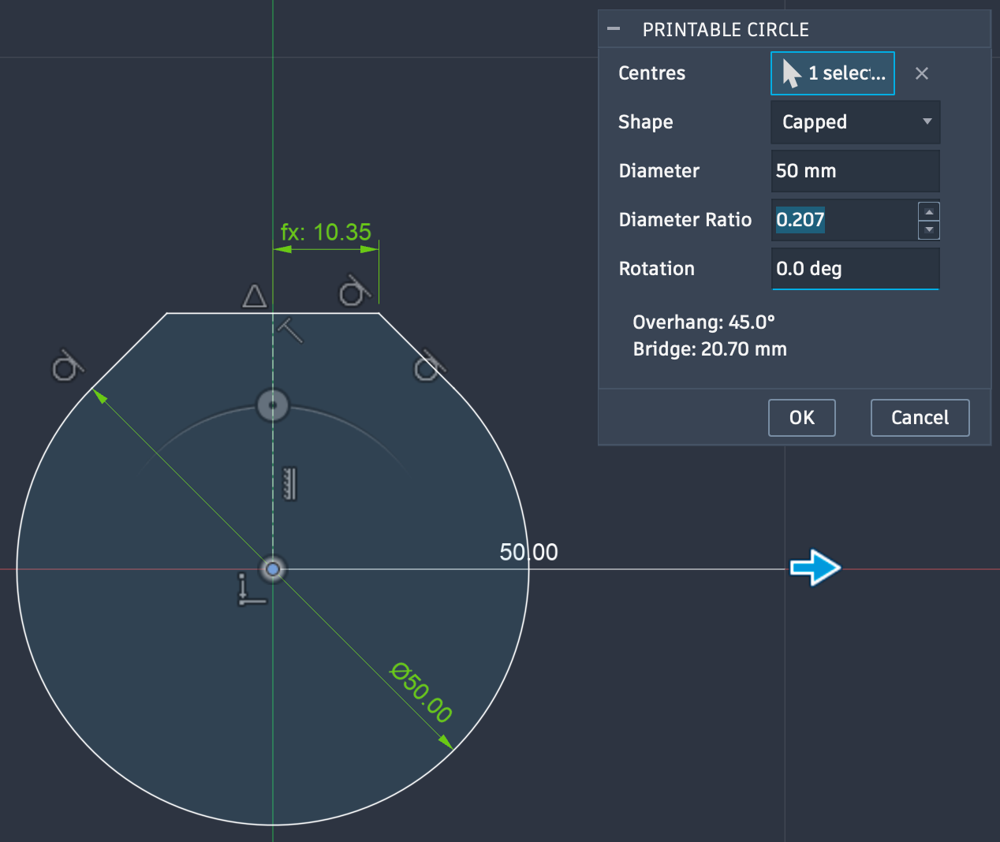
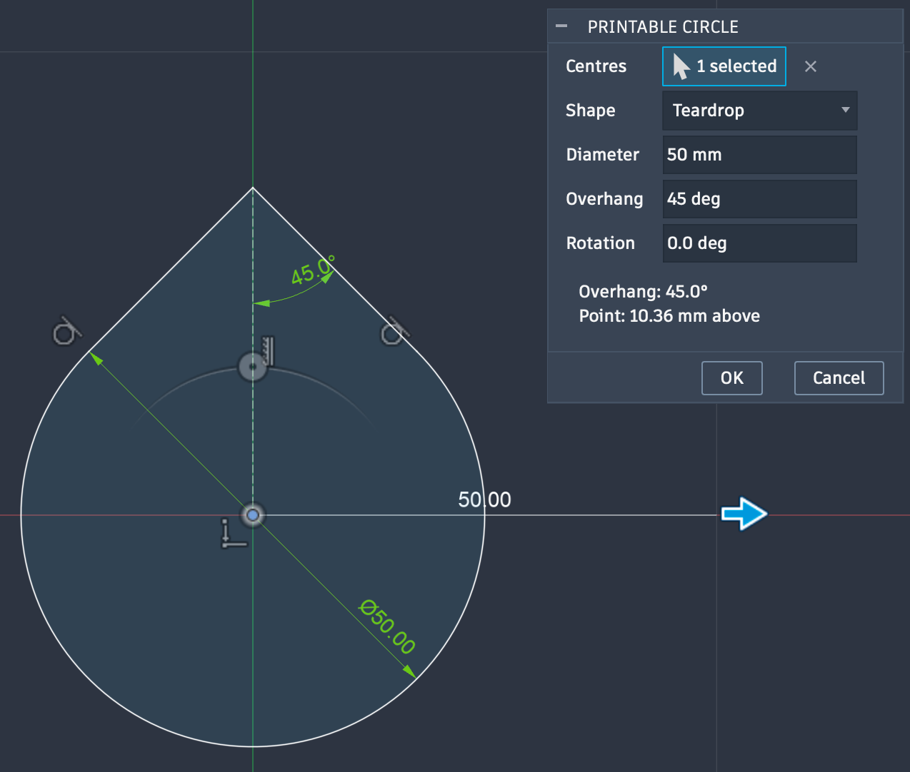
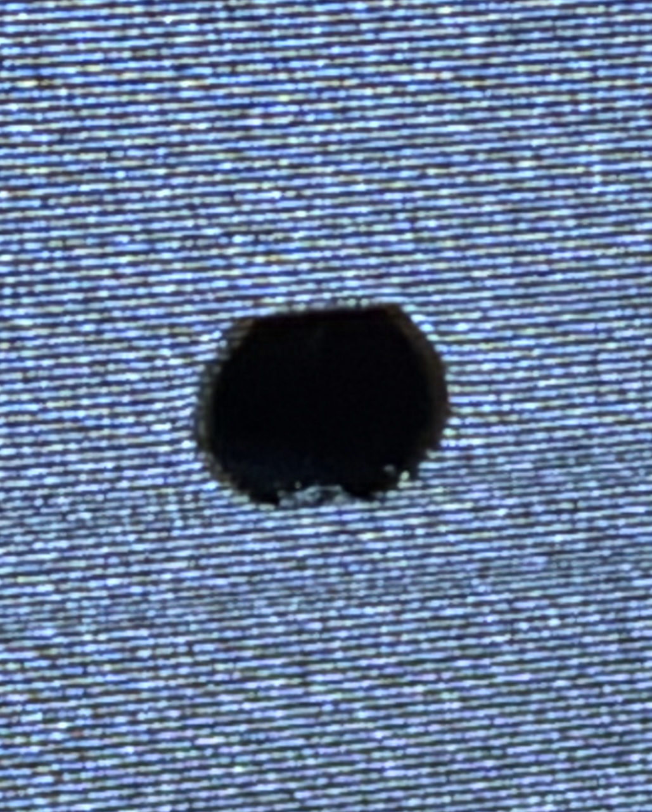
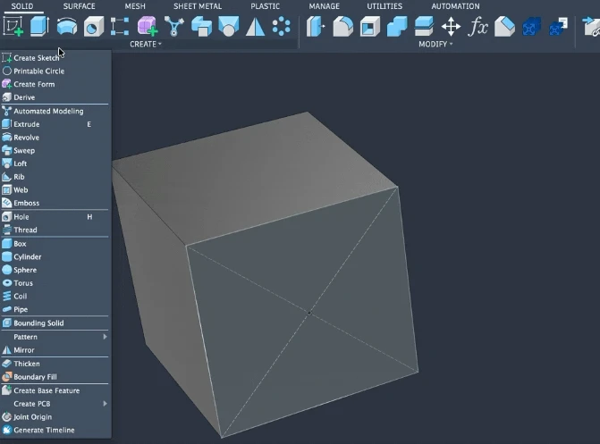
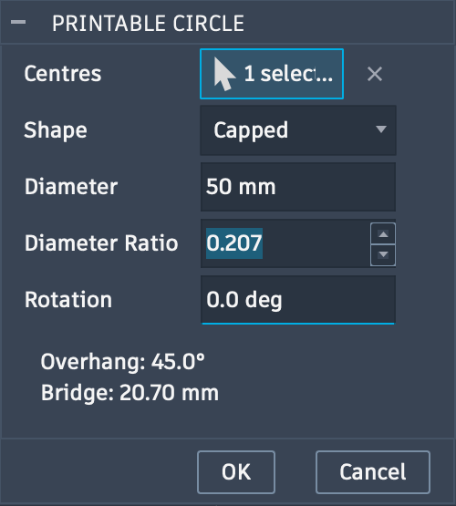

# Printable Circle for Fusion

Printable Circle is a Fusion sketch tool for drawing round profiles that can be printed upright on an FDM printer without supports. A normal circle has a steep overhang at its top, which needs supports to print. A capped circle swaps that top for a flat line with two side walls that meet the circle at a tangent, so the overhang stays within what a printer can bridge easily.

* The flat tangent bridge on top of the circle will touch the edge of a fastener, so you don't lose contact on top as you do with teardrop shapes.
* The flat top sits on the circle's highest point. It is about 41% of the diameter wide by default.
* The capped circle has the same overhang angle at any size. At the default width it is 45° from vertical, which will print without supports with default slicer settings.
* A teardrop shape is also available. It has no bridge: the side walls carry on until they meet at a point.

  
  
  

## Install

1. Download this repository (green Code button → Download ZIP) and unpack it, or clone it.
2. Copy the `PrintableCircle` folder from inside it into Fusion's add-in folder, keeping that exact name:
   * Windows: %appdata%\Autodesk\Autodesk Fusion 360\API\AddIns
   * macOS: ~/Library/Application Support/Autodesk/Autodesk Fusion 360/API/AddIns
3. Restart Fusion. The add-in starts automatically; if not, start it under Utilities → Add-Ins → Scripts and Add-Ins.

## Use

### Sketch Mode

**Create › Circle › Printable Circle:** draws into the sketch you are editing.

### Solid Mode

**Create › Printable Circle:** asks for a plane or face first, then creates a new sketch on it. Then select one or more points to use as centres, such as a vertex on the face, a sketch point or a construction point.

### Controls

| Input | What it does |
|---|---|
| Centres | The point each shape is centred on. Select several points to draw one shape at each. Nothing is drawn until you select at least one. |
| Shape | **Capped** draws a circle with a flat top. **Teardrop** has no flat: the side walls carry on until they meet at a point. |
| Diameter | The circle's diameter. Type a value or drag the arrow. |
| Diameter Ratio | Capped only. Half the flat's width as a fraction of the diameter, from 0.05 to 0.45. A smaller value makes the side walls steeper and the top bridge shorter. |
| Overhang | Teardrop only. The side-wall angle from vertical, from 15° to 75°. The default of 45° prints without supports. |
| Rotation | Turns the top away from sketch +Y.|

Below the inputs, the dialog shows the side-wall angle from vertical (**Overhang**). For a capped shape it also shows the length of the flat top your printer must bridge (**Bridge**), and for a teardrop how far the tip sits above the circle (**Point**).

## Editing afterwards

Each shape is fully constrained, so it can't be dragged out of shape by accident.

- **Linked copies:** shapes drawn in one go are linked. The first point you selected carries the dimensions and the rest follow it, so one edit resizes or rotates them all.
- **Resize:** edit the diameter dimension. The flat's half-width dimension is set to diameter × ratio, so the rest of the shape follows.
- **Teardrop walls:** edit the angle dimension at the teardrop's tip to change its overhang.
- **Defaults:** the dialog opens with the last values you used, which are stored in `PrintableCircle/settings.json`.

## Development

- **Tests:** `python3 -m unittest discover -s tests` checks the geometry maths without Fusion.

## License

Printable Circle is released under the [MIT License](LICENSE).
