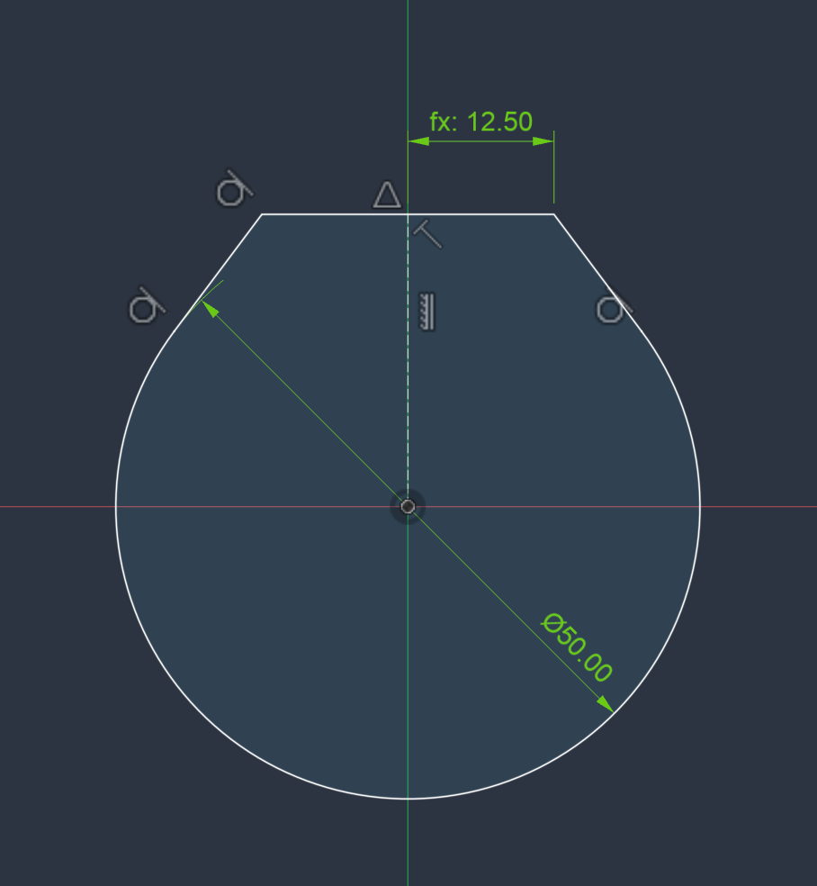
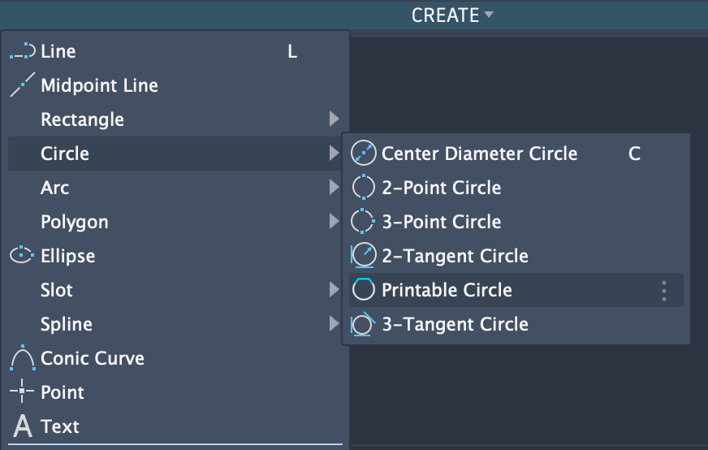
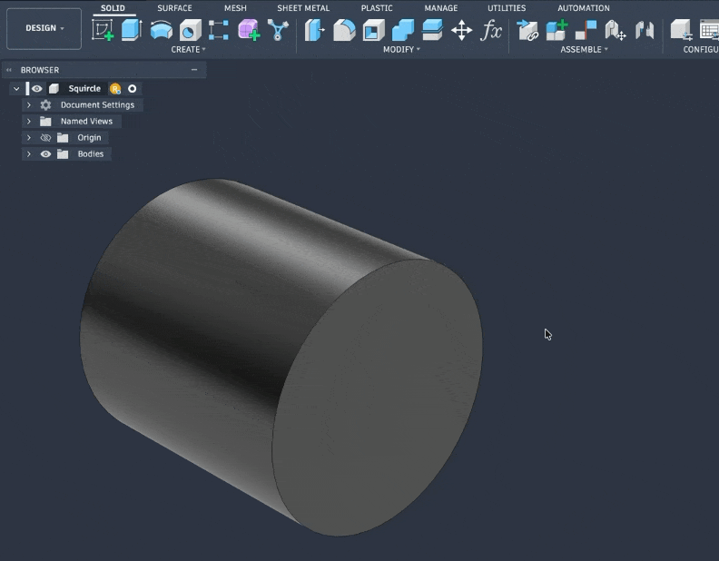

# Squircle for Fusion

Squircle is a Fusion sketch tool for drawing round profiles that can be printed upright on an FDM printer without supports. A normal circle has a steep overhang at its top, which needs supports to print. A squircle swaps that top for a flat line with two side walls that meet the circle at a tangent, so the overhang stays within what a printer can bridge easily.

* The flat tangent bridge on top of the circle will touch the edge of a fastener, so you don't lose contact on top as you do with teardrop shapes.
* The flat top sits on the circle's highest point. It is half the diameter wide by default.
* The squircle has the same overhang angle at any size. At the default width it is 45° from vertical, which will print without supports with default slicer settings.

## Install

1. Download this repository (green Code button → Download ZIP) and unpack it, or clone it.
2. Put the folder into Fusion's add-in folder and make sure it is named exactly `Squircle` (a ZIP download unpacks as `Squircle-main`, rename it):
   * Windows: %appdata%\Autodesk\Autodesk Fusion 360\API\AddIns
   * macOS: ~/Library/Application Support/Autodesk/Autodesk Fusion 360/API/AddIns
3. Restart Fusion. The add-in starts automatically; if not, start it under Utilities → Add-Ins → Scripts and Add-Ins.

## Use

### Sketch Mode

**Create › Circle › Squircle:** draws into the sketch you are editing.

### Solid Mode

**Create › Squircle:** asks for a plane or face first, then creates a new sketch on it. By default the origin is the centre point of the face (if it has one), or the origin. You can specify any point on the face to use as the centre.

### Controls

| Input | What it does |
|---|---|
| Centre | The point the circle is centred on. Leave it empty to use the sketch origin. |
| Diameter | The circle's diameter. Type a value or drag the arrow. |
| Half-width ratio | Half the flat's width as a fraction of the diameter, from 0.05 to 0.45. A smaller value makes the side walls steeper and the top bridge shorter. |
| Rotation | Turns the flat away from sketch +Y.|

Below the inputs, the dialog shows the side-wall angle from vertical (**Overhang**) and the length of the flat top your printer must bridge (**Bridge**).

## Editing afterwards

Each squircle is fully constrained, so it can't be dragged out of shape by accident.

- **Resize:** edit the diameter dimension. The flat's half-width dimension is set to diameter × ratio, so the rest of the shape follows.
- **Defaults:** the dialog opens with the last values you used, which are stored in `Squircle/settings.json`.

## Development

- **Tests:** `python3 -m unittest discover -s tests` checks the geometry maths without Fusion.

## License

Squircle is released under the [MIT License](LICENSE).
